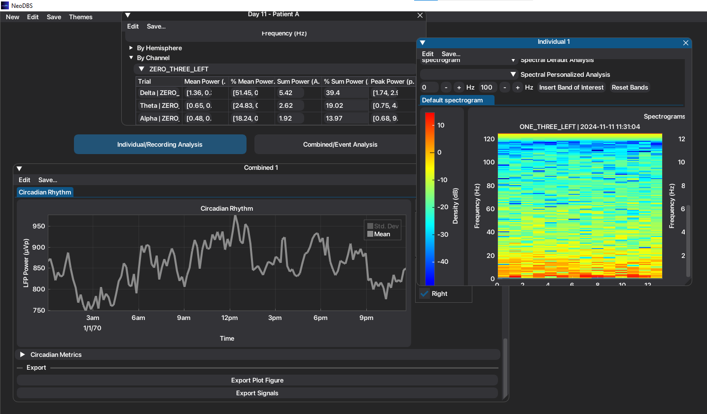
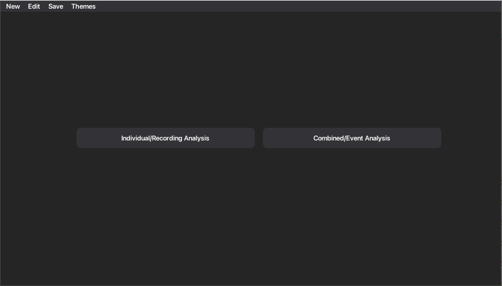
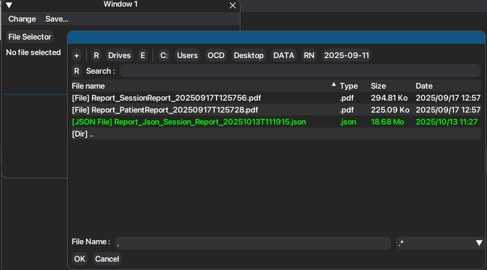
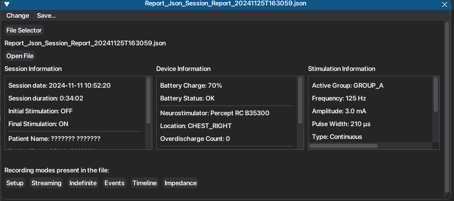
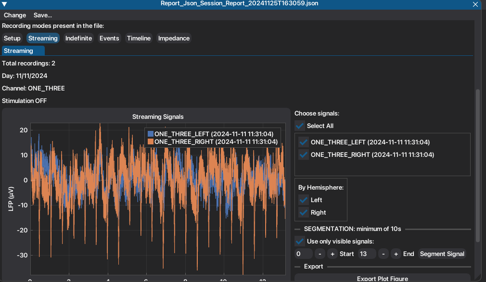
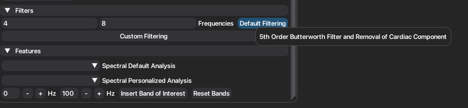
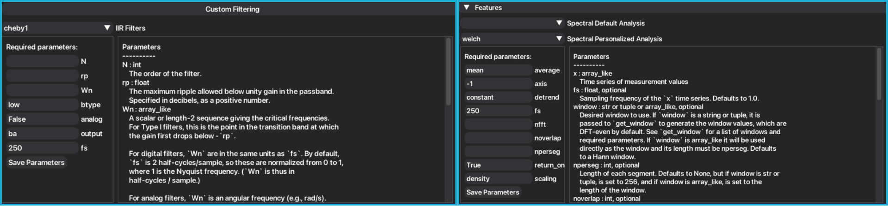
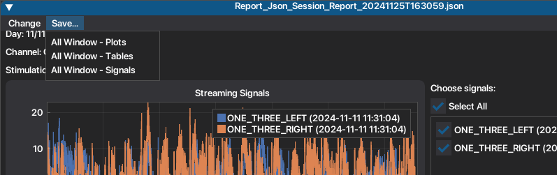

First Usage
===========

.. meta::
   :description lang=en: The starting point for the tutorial set.

NeoDBS is a platform designed for maximal user-experience, with every item and functionality optimized for 
easy data analysis and natural workflow. *Even for unexperienced users in signal processing and analysis.*
With this, NeoDBS was developed to allow **several workspaces open symultaneously**. For that, the user can 
open multiple windows, each one corresponding to an independent workspace. 

Inside each window (or workspace), all the mentioned data is organized and accessed in a hierarchical order:
* Window --> File(s)
* Tab --> Recording(s)
* Child Tab --> Recording Analysis

This facilitates access to data, while ensuring multiple independent and simultaneous analysis pipelines for 
each recording available. 

Types of Workspaces
-------------------

As mentioned above, the user has the possibility to work with several workspaces simultaneously. 
Additionally, NeoDBS offers two different types of workspaces (windows). The **Individual Window** and the
**Combined Window**. While they share the majority of functionalities, their final goal differs.

Individual Window
^^^^^^^^^^^^^^^^^

The **Individual** window is to analyze a single recording session, focusing on the evolution of signals and 
events inside the same session. Therefore it includes functionalities like:

* Event marking in time-domain signals, and their time-frequency domain methods, according to user input;
* Compute joined time-frequency domain methods in same-channel recordings;

These are exclusive to this workspace, in order to enhance computing power and hetereogeneity in workspaces.

Combined Window
^^^^^^^^^^^^^^^
Unlike the individual window, the **Combined** window, allow the selection of multiple files, focusing therefore on 
evolution of the signals across different recording sessions. Additionally, it includes functionalities such as:

* Event-locked segmentation, automatically epoching recordings according to user input.

These functionalities are further explained in :ref:`here <ela>`.

General Workflow
----------------

Here follows a simple workflow for analysis using NeoDBS. You can open several independent workspaces (windows) that have
a browser-like design, offering maximal user-experience, for all levels of data analysis experience.

1. **Select type of analysis to be performed:** **Individual Window** (only analyzes one file - focused on the recording) or **Combined Window** (analyzes as many files as selected - allows event-locked analysis).

2. **Select the recording session's file(s)**, in JSON format, to be analyzed.

3. Window will present **session, device and stimulation information** for each recording session.

4. Recordings can be accessed by clicking on the **respective recording mode button**. 
5. **Each recording mode will have its respective tab**, with the associated recordings and functionalities. Preprocessing and spectral analysis methods will only be applied to the selected signals (visible on the main plot of tab).

6. **Default methods** have the parameters predefined for an easier analysis, properly adapted for the recordings configuration.

7. **Custom methods** allow the parameters to be adjusted according to the user needs. Documentation of the selected method and required parameters will appear to aid the user in selecting the best parameters. 

8. **Signals, plots and tables can be easily exported** either individually, per window (workspace) or all windows at once.

