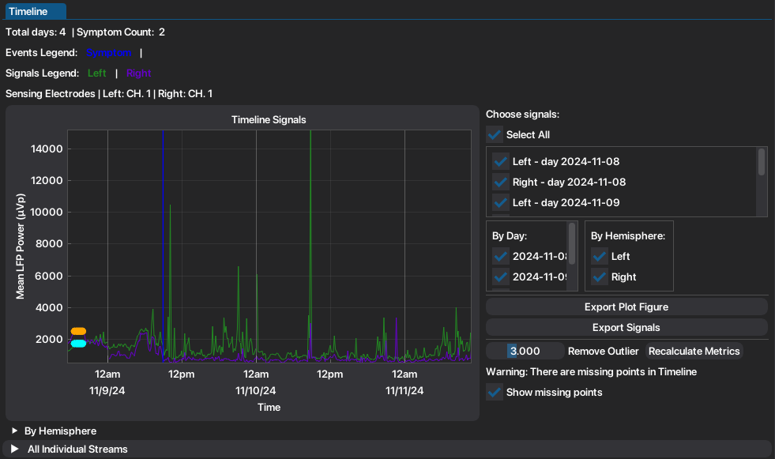
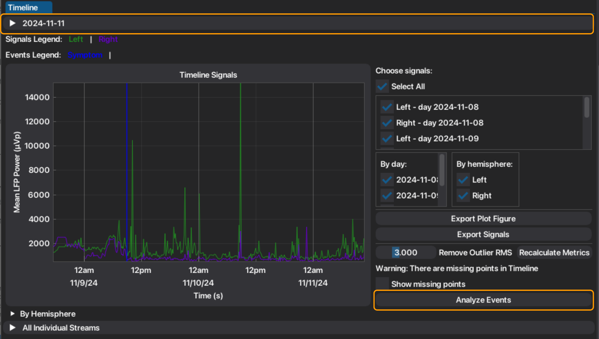
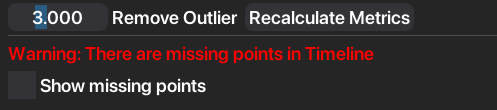

At-Home Data
============

Medtronic's Percept BrainSense™ technology allows at-home recordings to track the effects of symptoms, 
medication and routine outside of the clinic. There are two at-home recording modes: *Timeline* and *Events*.
*Timeline* records the long-term LFP signal troughout all day and *Events* record a 30 second snapshot, manually 
triggered by the user to record important events such as symptoms, medication, etc.
The chronic LFP recordings are acquired from a pre-selected contact pairs, and are restricted to bipolar settings 
and the stimulation electrodes used. 

Timeline
--------

The BrainSense™ *Timeline* mode acquires the signal power of a pre-defined sensing band (5 Hz bandwidth) every 
10 minutes. To access the signals, the user must select the respective tab. Automatically, the chronic recordings
and the patient-marked events are plotted. Respective information of the sensing configuration is also displayed, as well as 
the plot legend.

Recordings from the left hemisphere appear with the color green, and recordings from the right hemisphere 
appear with the color purple. Marked events appear as vertical lines, marking the moment of the event. Additionally,
power features are extracted per signal (mean power, peak power and peak time). Extracted features are also organized
into groups to facilitate exportation of analog/related signals, for offline analysis.

The image above represent the *Timeline* tab in the **Individual** window. When in the **Combined** window, has access 
to event-locked analysis functionalities, described below. Additionally, the information correspondant to the sensing
configuration of each file selected, is organized under the correspondant header.

Outlier Removal
^^^^^^^^^^^^^^^

Because this a signal acquired with a very low resolution, it is very important to be careful when 
infering conclusions from this signals. NeoDBS offers an outlier removal filter, based on the root mean square (RMS)
of each signal (per channel-day) and also allows the user to see moments where there are missing points. Extracted 
features can be recalculated as many times needed to allow the user to extract the metrics to the filtered signal.

To apply the outlier removal, the user must select the factor value. This factor is multiplied to the computed RMS 
to define the value of the threshold. If the LFP value is above the threshold it is considered an outlier and replaced
by the RMS.

1. Select threshold.
2. The filtered signals will update the main plot.
3. If the user wants to recalculate timeline metrics, press "Recalculate Metrics".
4. To see missing points from recordings, toggle checkbox "Show missing points".

Event-locked Analysis
^^^^^^^^^^^^^^^^^^^^^
When using the **Combined** window, the user has the possibility to epoch all the events marked by the user at-home,
allowing an automatic event-locked analysis of the chronic recordings. 

1. Press "Analyze Events".
2. A new plot will appear with the automatically segmented signals, centered around the marked event.
3. If the original signals were filtered, the epochs will be made from the filtered signals.
4. The same metrics extracted for the *Timeline* recordings will be extracted for the epochs, the epoch before the event and the epoch after the event.

Circadian Rhythm
^^^^^^^^^^^^^^^^

Events
------

The BrainSense™ Events mode (LFP Snapshots) is for at home usage and is combined with
the BrainSense™ Timeline mode. Patients manually mark events with a wireless device, time
stamping events in the BrainSense™ timeline data and triggering recording of high definition LFP
for 30s. The average PSD estimate is also computed and stored.
