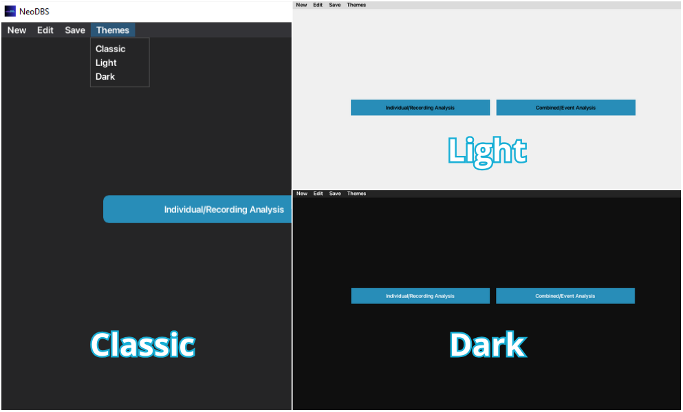
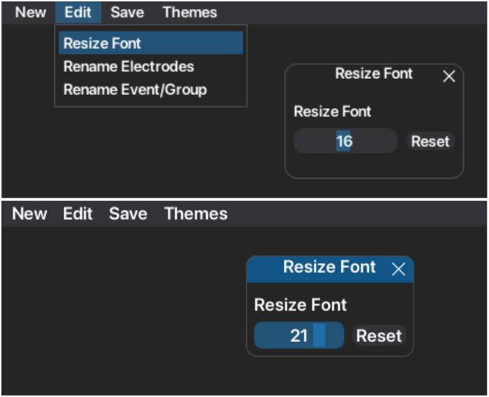
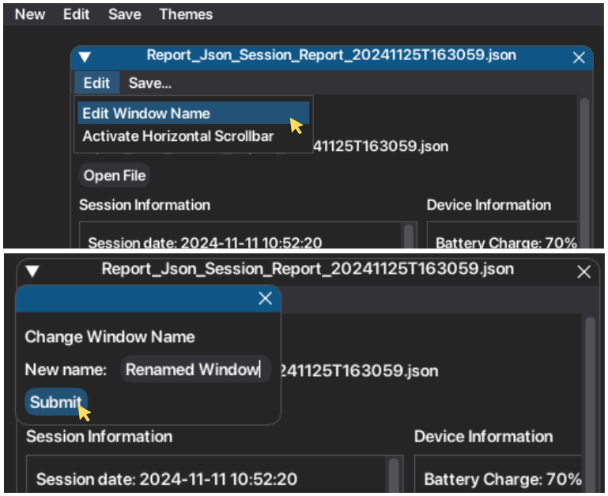
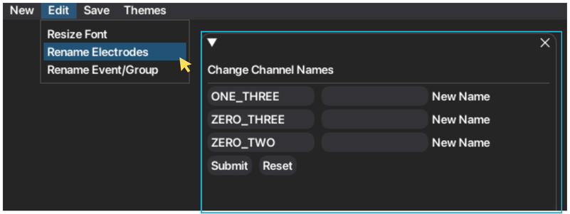
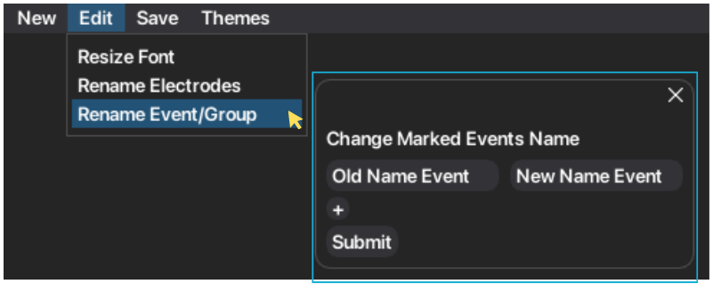
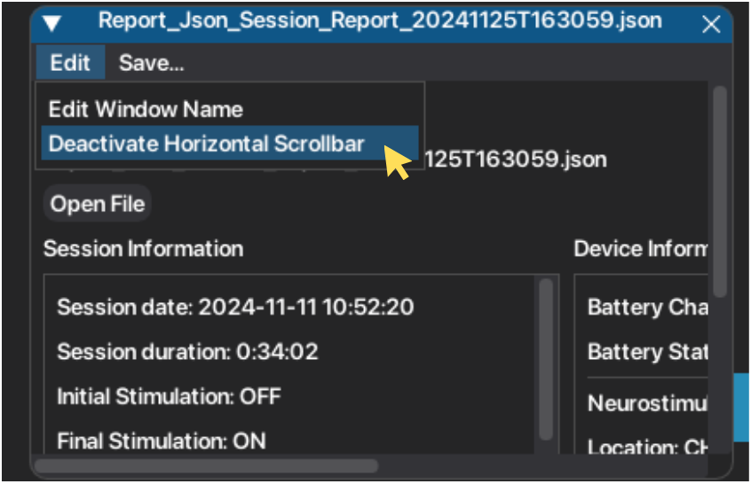
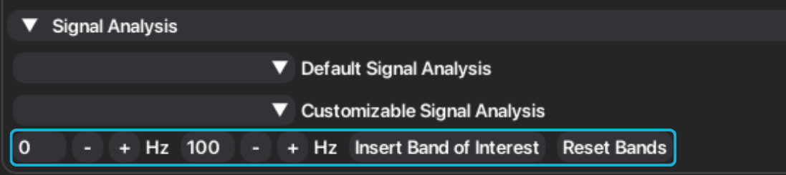

Extra Features
==============

Beyond signal processing features, NeoDBS is a customizable platform at the user level. This includes 
customizing the graphical user interface (GUI), workspaces, nomenclature of recordings, and others. 
Since this platform is designed to foment research, NeoDBS development took in consideration researcher's 
and clinician's needs when performing signal and data analysis. Therefore easy manipulation and exportation 
of data are strong features of this platform.

GUI Customization
-----------------

User experience is one big focus of the platform, by creating an easier environment to perform difficult tasks such as 
signal processing. 

Themes
^^^^^^

The user has available three different themes. **Classic, Light** and **Dark**. Default theme is Classic.

1. On the main window menu, select "Themes".
2. Select the theme to be applied.

Font Size
^^^^^^^^^

Font can be easily resized for best readibility.

1. On the main window menu, select "Edit".
2. Press "Resize Font".
3. Select the font size, by sliding the button. Font will be instantly updated.
4. To go back to default font size (16), press "Reset".

Rename Window
^^^^^^^^^^^^^

To optimize workspace organization and acessibility, windows can be renamed.
Individual window's name default to the selected JSON file name, while Combined window's name default to 
"Combined #", with # being the number of the window.

1. On the respective window menu, select "Edit".
2. Press "Edit Window Name".
3. Write the new name and press "Submit".

Rename Channels
^^^^^^^^^^^^^^^

Recording channels (ZERO_THREE, ONE_THREE, ZERO_TWO) can also be renamed, to facilitate interpretation of analysis.
The updated names on new instances of the recording channels. If an item with mention of the recording channels is 
already created prior to the renaming, it will **not** be updated. Only future instances.

1. On the main window menu, select "Edit".
2. Press "Rename Electrodes".
3. Write the new name(s). Press "submit" to apply changes.
4. Future instances will appear with the updated names, on **all** workspaces.

Rename Events
^^^^^^^^^^^^^

At-home marked events are saved into the respective group event. These groups are defined by the clinician, when 
programming the DBS system for at-home chronic recordings. If an item with mention of the event/group name is 
already created prior to the renaming, it will **not** be updated. Only future instances.

1. On the main window menu, select "Edit".
2. Press "Rename Events/Groups".
3. Write the old event/group name and the new name.
4. To add more alterations, press "+".
5. Press "Submit" to apply changes.
4. Future instances will appear with the updated names, on **all** workspaces.

Horizontal Scrollbar
^^^^^^^^^^^^^^^^^^^^

To allow windows to have customizable sizes, while accessing all information, horizontal scrollbar can be 
activated (or deactivated). By default, windows have the horizontal scrollbar deactivated.

1. On the respective window menu, select "Edit".
2. Press "Activate Horizontal Scrollbar".
3. To deactivate, press the same button.

.. note::
    If the user has a mousepad, the horizontal scrollbar it is not required to navigate horizontally. 
    Due to the GUI library configuration, it is not very recommended to activate the scrollbar, eventhough it has a very 
    useful functionality.

Tables
^^^^^^

In signal analysis, extracted features are organized into tables for easy visualization and exportation. 
Additionally, the name of all rows can be customized.

Spectral Band Analysis
----------------------

Signal processing and analysis relies heavily on the study of the spectral component of the signal. Beyond the 
classic frequency bands of neural signals (Delta, Theta, Alpha, Beta and Gamma), researchers also have a need 
to study how specific and unique frequency bands behave. Therefore, in NeoDBS, the user can add more bands to 
be included in signal analysis and feature extraction. 

1. In the respective recording mode tab, open the collapsing header named "Signal Analysis".
2. Fill in the respective input spaces for the bounding values of the new frequency band.
3. Press "Insert Band of Interest", to add the new band.
4. The added band will be included in future spectral analysis inside the respective tab.
5. The user can add multiple bands.
6. To reset to the default bands, press "Reset Bands".

Export
------

As mentioned above, NeoDBS offers exportation functionalities for all created plots, tables and series.
They can be **individually** exported, exported **by window** or **export all** created items in the platform.

1. To save individually the created item, press "Export Plot/Signals" or "Save Table", according to the item of interest.
2. To save all the chosen items per window, press "Save..." in the window menu bar. Items are saved into a folder with the window name.
3. To save all chosen items in the platform, press "Save" in the main window menu bar.
4. Select the type of exportation.

.. note::
    Because the supporting GUI library (DearPyGui) has no functionality to export plots, these are properly 
    converted into MatplotLib plots and saved into png files. The conversion is made to replicate as close as possible 
    the plot in NeoDBS. 
