Signal Analysis
===============

Acquiring intracranial recordings allows the possibility to analyze how the brain activity changes 
across different moments and locations. To properly study how the characteristics of the intracranial 
signals and oscillations change, several tools can be used. These changes are visible in the different 
domains: time, frequency and time-frequency, for which NeoDBS is fully prepared to analyze.

Signal analysis methods and tools have to be fine-tuned to the acquiring conditions so conclusions can be made 
with precision and certainty. However, for users with no background or knowledge in 
signal processing, this task can turn out to be very difficult. 

Therefore, NeoDBS took an effort in creating robust pipelines that can be used by every user, researcher or 
physician, without any in-depth knowledge. To access these prepared methods, access **"Defaul Signal Analysis"**,
under the header "Signal Analysis". 

Nonetheless, signal analysis parameters can be fully customized to the researcher's needs. When customizing the parameters, 
the user will be aided by the documentation and default parameter's values, as seen in the following picture. To 
access the customizable methods, access **"Customizable Signal Analysis"**, under the header "Signal Analysis". 

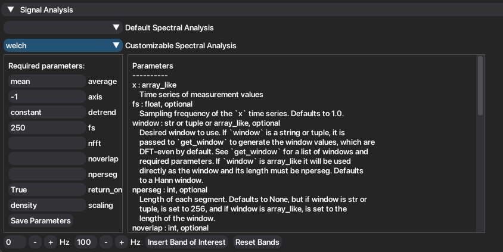

NeoDBS offers the following signal analysis tools for time-domain signals, both on the **default** and **customizable** pipelines:

* Power Spectral Density (PSD) Estimation
    * Periodogram
    * Welch PSD
    * DPSS Multitaper
* Coherence
    * Welch Coherence
    * Multitaper Coherence
* Cross-Correlation
* Spectrogram
* Wavelet
* Coherogram 
* Phase-Amplitude Coupling 

Additionally, to further enhance spectral analysis, the user can add more frequency bands to be included in the analysis.
The minimum interval for the frequency band is 2 Hz and can be added using the following buttons:

The default bands are: Delta (0.1-4 Hz), Theta (4-8 Hz), Alpha (8-12 Hz), Beta (12-30 Hz) and Gamma (30-100 Hz).

PSD Estimation
--------------

Analyzing the frequency component of signals is a very important tool when researching brain activity and 
biomarkers and neural signatures. Brain activity is characterized by rhythmic oscillations, whether in 
several important processes, like sleep, or by communicating within different regions and neural populations. 
It is crutial to look at how the energy of these oscillations changes in different moments.
Using PSD estimation we can see how the power of each frequency differs. 

The available PSD estimation methods present all the same information, with different time and spectral resolutions, which can 
be beneficial to different tasks or research goals. You can find a more detailed explanation in: https://www.mathworks.com/help/signal/ug/nonparametric-methods.html.

1. Under the "Signal Analysis" header, choose between **default** or **custom** signal analysis. 
2. Choose which PSD estimation method you want to implement: **Periodogram, Welch or DPSS**.
3. If you chose **custom** analysis, fill the required parameters and press **"Save Parameters"**. Then, press **"Plot filtered signal"**.
4. A new child tab will be created, under the name of the method employed, with the result of the analysis and extracted features.

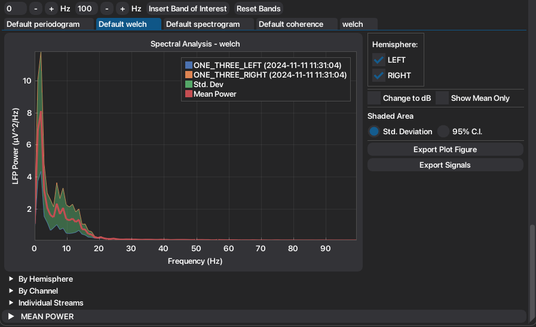

5. Mean and standard deviation are recalculated with every signal toggle.
6. To convert the PSD between original units and dB, toggle **"Change to dB"**.
7. To show only the mean PSD, and respective standard deviation, toggle **"Show Mean Only"**.
8. The standard deviation can be converted to the 95% Confidence Interval, by choosing in the radio button under **"Shaded Area"**.
9. Automatically extracted features are organized into convenient groups, to facilitate visualization and exportation of features.
10. Plots, signals and tables can be easily exported.

Band Power Over Time
^^^^^^^^^^^^^^^^^^^^

When more than one recording from the same-channel is present when employing the PSD method, the user can see how the mean 
power of each frequency band changes over time.

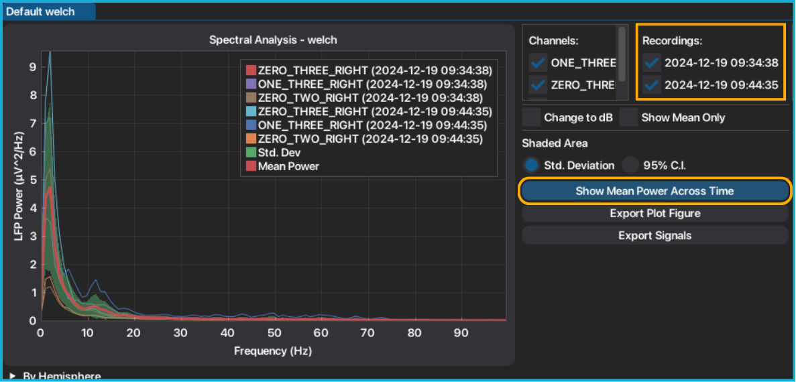

1. Press **"Show Mean Power Across Time"**.
2. The mean power per band, per channel, is plotted. The respective dates are indexed on the right side of the plot. 

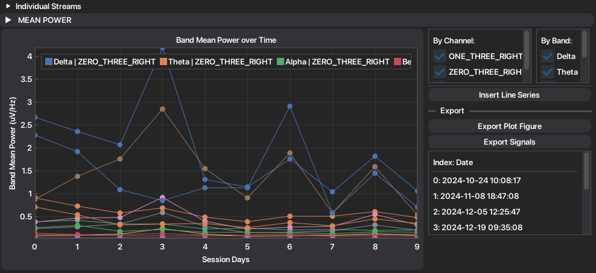

3. If you want to add an external information, press **"Insert Line Series"**. This will accept an txt file, with the following structure: first line is the label of the series, and every line stores the value of each time point.

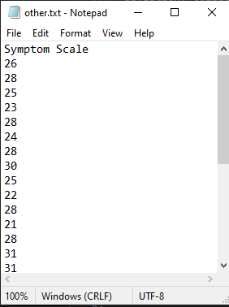

4. The inserted series is plotted on secondary axis allowing the user to zoom and move around the inserted values independently from the mean power.

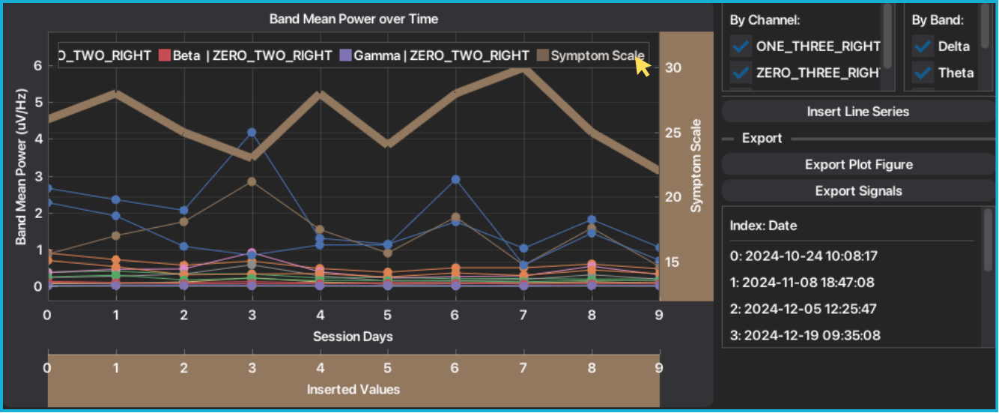

5. You can insert multiple line series, although it is not recommended.

Coherence
---------

Coherence is a tool that analyzes the synchrony between two signals, serving tipically to study functional connectivity between regions and populations.
Coherence values ranges from 0 to 1, with 0 meaning no linear relationship at the frequency and 1 representing
perfect linear coupling. 

1. Under the "Signal Analysis" header, choose between **default** or **custom** signal analysis. 
2. Choose which coherence method you want to implement: **Coherence** (Welch) or **Multitaper Coherence**.
3. Select which combination of signals you want to analyze. After, press **"Plot Coherence"**.

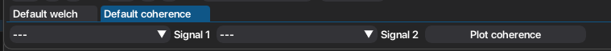

4. Both Absolute and Imaginary components of coherence are plotted and features are automatically extracted. Features are organized into tables.

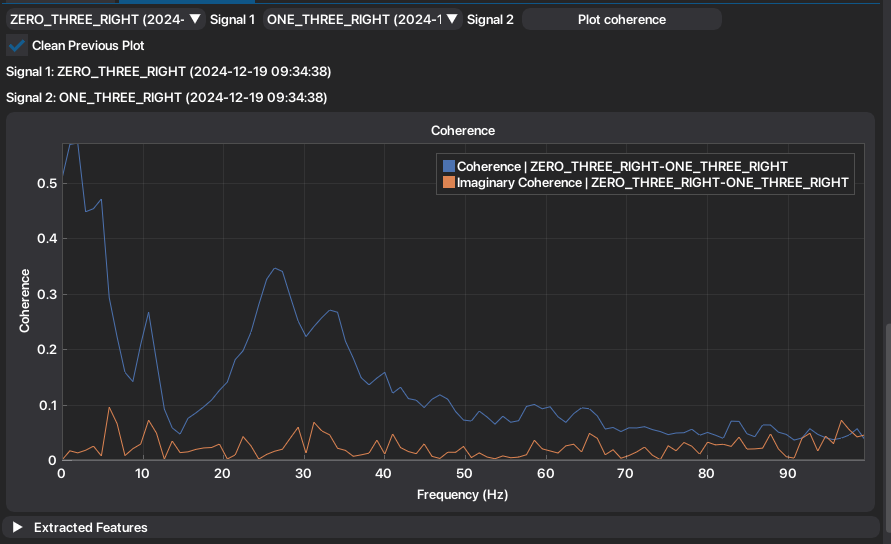

5. To plot a new coherence, repeat the process from step 3. If you want to maintain the previous computed coherence plotted, unselect the checkbox **"Clean Previous Plot"**.

6. If you selected the **Multitaper Coherence**, you can also compute the coherogram. Check more in :ref:`here <coherogram>`. 

7. Plots, tables and signals are easily exported.

Time-Frequency Domain Representation
------------------------------------

To compute Time-Frequency Domain (TFD) representation, NeoDBS is able to compute the **Welch Spetrogram** or **Wavelet**, available on both default and customizable pipelines.

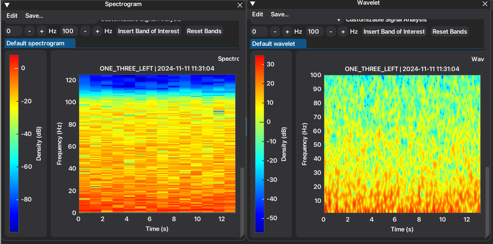

In the **Individual** window, it allows for spectrograms to be 
computed per signal or to join recordings (if there are multiple recordings from the same channel). Additionally, if there are any marked events,
those will also be automatically included in the representation of the spectrogram.

In the **Combined** window, spectrogram is only available for event-locked segments (after inserting events). 

.. warning::
    Since computing spectrogram has a high computational cost, it is advised to perform this method on smaller segments, or 
    to properly account for segment duration when customizing spectrogram parameters. Number of computed spectrograms 
    also highly impacts the computational performance.

1. After selecting the **"Spectrogram"** method, the plot and respective buttons will be displayed. In the 
figure below we can see the example of the spectrogram being computed on an Individual window with marked events.

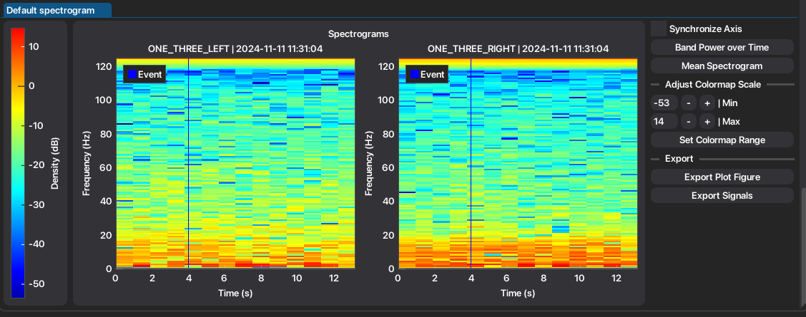

2. If more than you recording per channel is visible, the user must select between **joined** or **separate** spectrogram of the signals. By pressing the **"Joined Recordings"**, the spectrogram will be computed for the joined recordings by channel. Else, if you press **Separate Recordings** an individual spectrogram will be computed per recording.

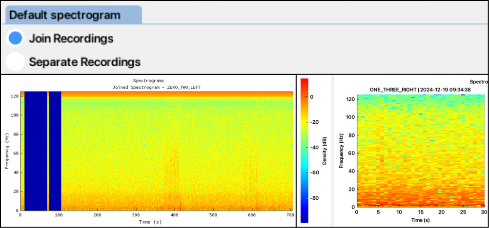

2. Toggle **"Synchronize Axis"** to synchronize axis between plots.
3. To plot the band mean power over time, per recording, press **"Band Power Over Time"**. See more in :ref:`here <bpot>`.
4. To compute the mean spectrogram, press **Mean Spectrogram**. The mean spectrogram and respective buttons will appear under the collapsing header named "Mean Spectrogram".

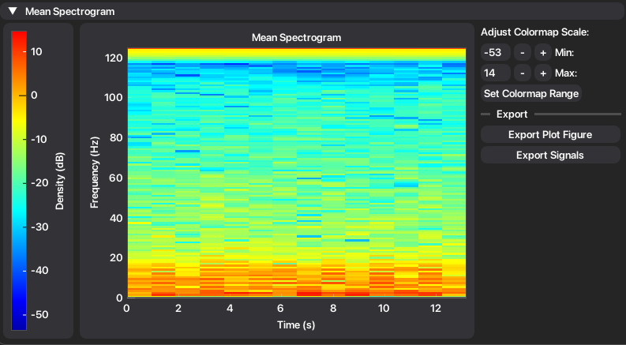

5. To adjust the colormap scale of all the plotted spectrograms, define the minimum and maximum values of the scale. After defining, press **"Set Colormap Range"**.

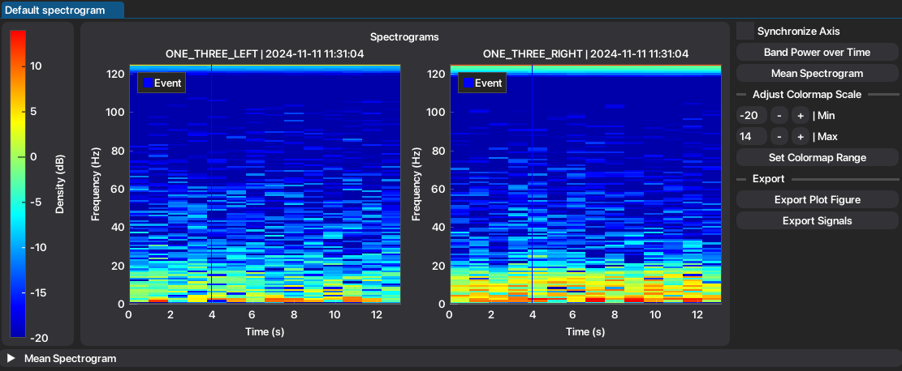

6. Exportation is facilitated in the respective buttons.

.. _bpot:
Band Power Over Time
^^^^^^^^^^^^^^^^^^^^

By pressing the **"Band Power Over Time"** button, the mean power of each frequency band will be extracted and plotted per recording. 

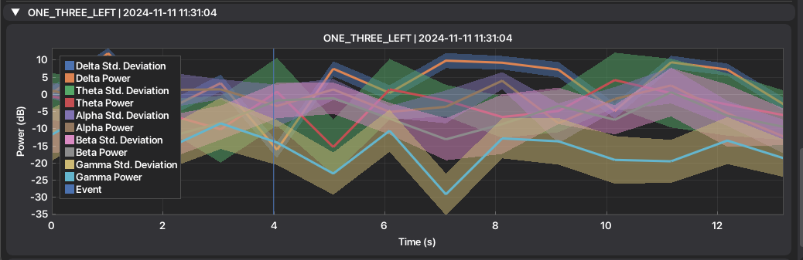

.. _coherogram:
Coherogram
----------

When selecting the **Multitaper Coherence**, user may also compute the coherogram, by pressing **"Plot Coherogram"**. 
Exportation of all signals, plot and tables is facilitated by the respective buttons.

This a very useful tool that allows to check how coherence between signals and frequencies change over time. However, 
coherogram does not mark inserted events as spectrogram does. 

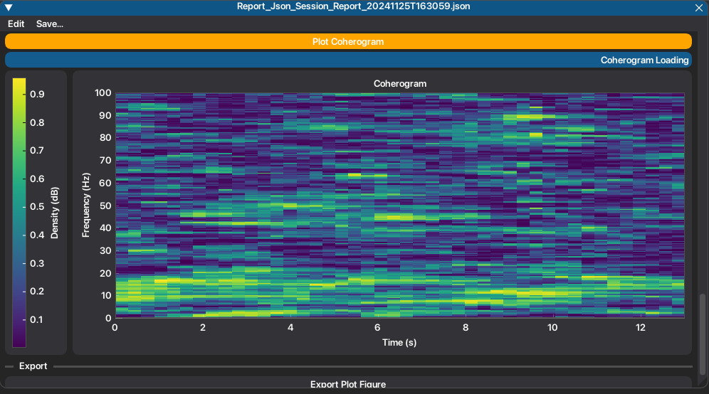

Band Coherence Over Time
^^^^^^^^^^^^^^^^^^^^^^^^

Additionally, band coherence over time is also computed automatically, in simultaneous with the coherogram. It can be
accessed under the collapsing header **"Coherence over time"**. Exportation is also facilitated.

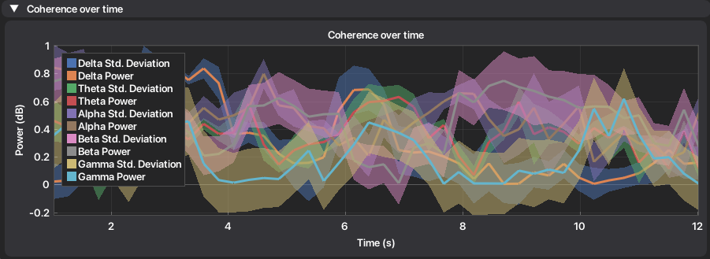

Phase-Amplitude Coupling
------------------------

Phase-Amplitude Coupling (PAC) is a cross-frequency coupling that allows to observe modulations, or coordination, between the phase of a signal with the amplitude of the second signal.
It is typically used to analyze the modulation between low-frequency phases and high-frequency amplitudes, reflecting interactions across different time scales (band frequencies) and spatial locations.
To quantify the degree of coupling, the Modulation Index (MI) proposed by Tort et al. for PAC analysis of neuronal signals was calculated. MI is calculated as the normalized difference between the maximum possible entropy and the
observed entropy, with **0** corresponding to **no coupling** and **1** to **strong coupling**. 

1. To compute the phase-amplitude coupling method, press **"PAC"**.
2. Select the signals to be analyzed, in **Signal 1** and **2**. 
3. Select the frequency bands to be analyzed, respective to the signals. From signal/band 1, the phase will be extracted. From signal/band 2, the amplitude will be extracted.
4. Once all parameters are filled, press **"Plot Phase-Amplitude Coupling"**. 

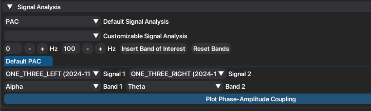

5. The respective representation of PAC will be displayed, as well as the extracted features. 

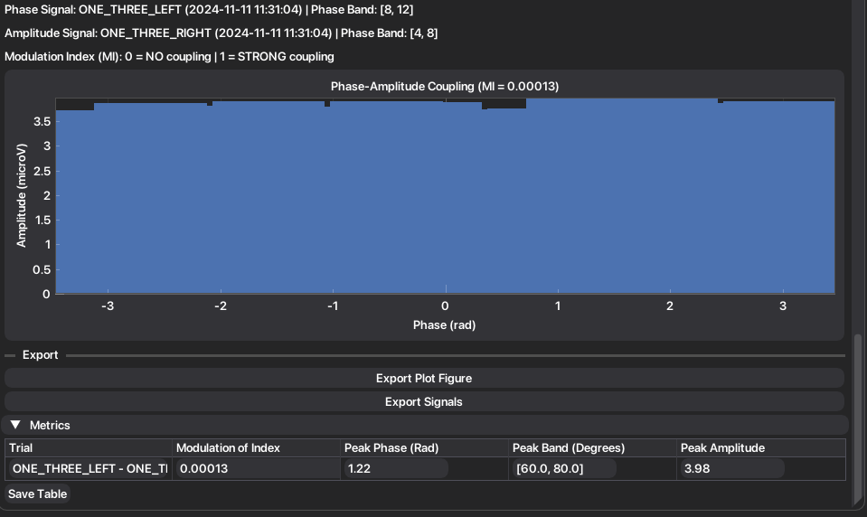

6. To compute a new pac, repeat the process since step 2. New metrics will be added to the table.

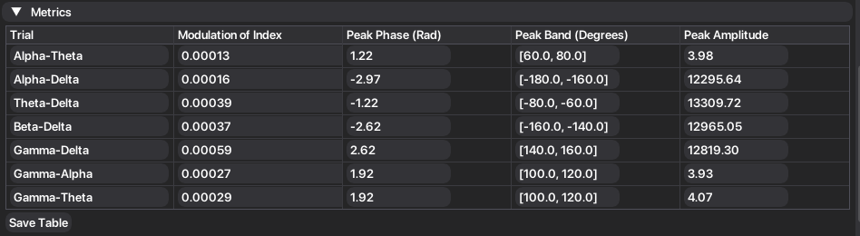

7. Exportation is also facilitated.

Cross-Correlation
-----------------

Cross-correlation (CC) is a powerful tool that can reveal synchrony or coupling between two different signals across time. It is typically used to study functional connectivity across different
brain locations. It is a normalized dimensionless metric, with **0** corresponding to **no correlation** between signals and **1** representing **maximum correlation**.

Half Max (HM) correlation and width (HMW) enables the investigation of the spread and periodicity of the correlation. HMW is calculated through
the intersection of the correlation signal and HM. **Narrow HMW** represent **very precise temporal coupling**, which may be a reflection of pathological coupling or over-synchronized frequencies.
For further offline feature analysis, the root mean square (RMS) correlation is extracted, to cancel out symmetric signals, while still representing the mean correlation across time. The maximum
correlation, and respective lag, are also extracted.

1. Press **"Cross-Correlation"**. 
2. If you want to compute CC per frequency band, toggle **"Band Cross-Correlation"**. Else it will compute CC for the entire spectrum.
3. Select the signals and press **"Plot Cross-Correlation"**.
4. The computed method and extracted features will be displayed.

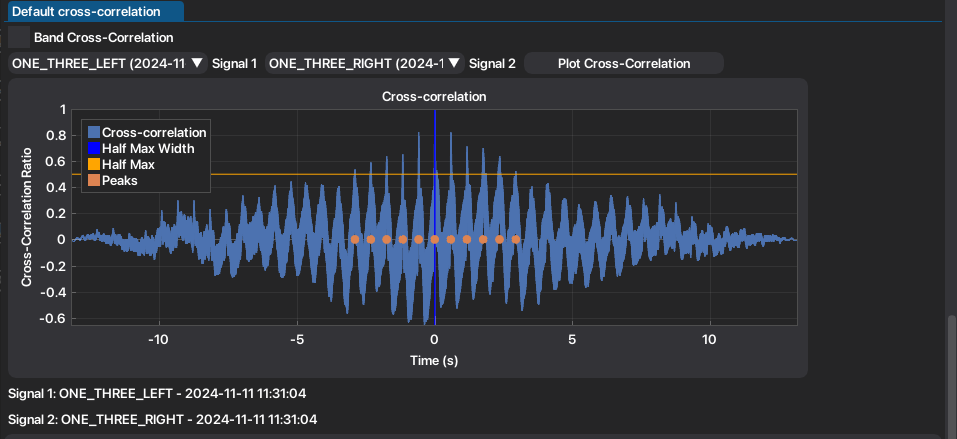

5. New extracted metrics will be added to the table. Toggling buttons appear to aid in visualization and exportation.

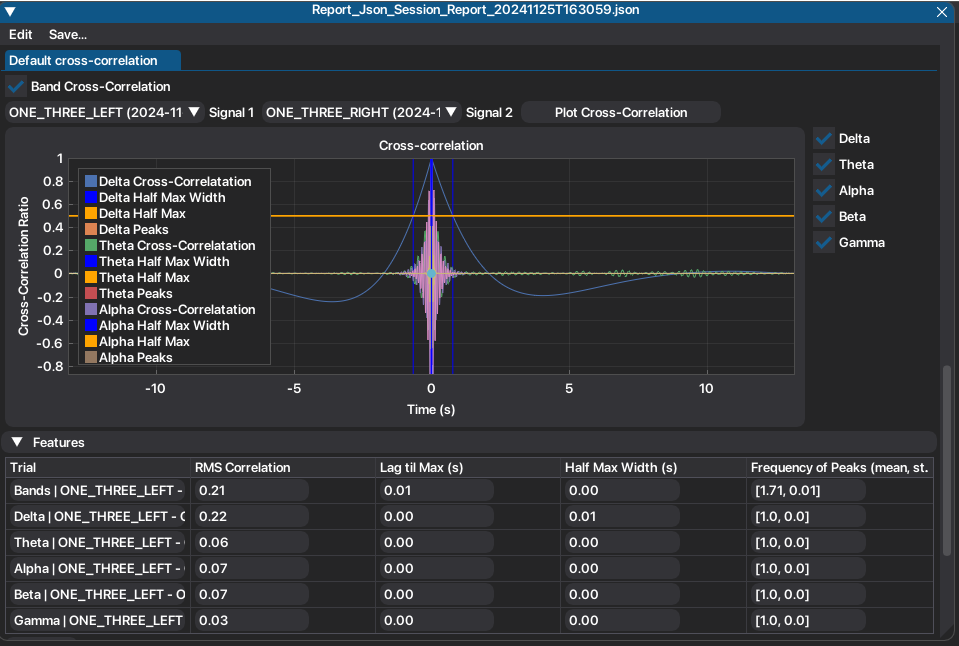

6. Exportation is also facilitated.