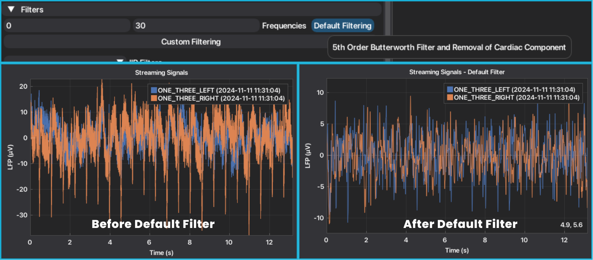
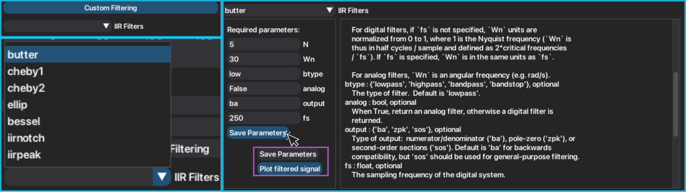
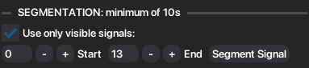
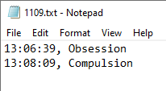
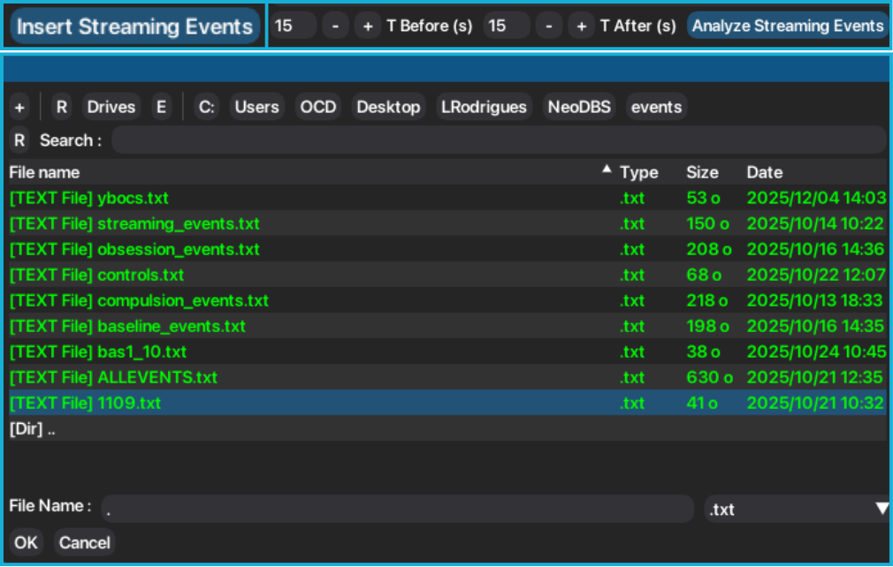
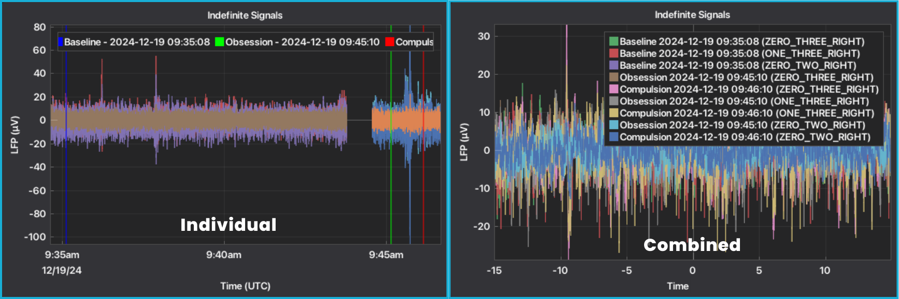

In-Clinic Data
==============

In this tutorial, a simple workflow is given to perform the analysis of recordings saved in the time-domain 
**(Streaming, Indefinite Streaming, Survey and Setup)**.
After selecting the type of window and file(s) to be analyzed, you must choose the type of recording you want 
to analyze, which will open a tab with the respective plotted signals and functionalities, as described in :doc:`First Usage <../quickstart/first_usage>`.

+--------------------+---------------+-------------+--------------------------+
| Mode               | Usage Context | Stimulation | Key Features             | 
|                    |               | Status      |                          |                          
+====================+===============+=============+==========================+
| *Setup*            | In-clinic     | On or Off   | Required before other    |
|                    |               |             | modes (except *Survey*); |
|                    |               |             | Records each segment for |
|                    |               |             | 21s each (~90s duration) |
+--------------------+---------------+-------------+--------------------------+
| *Survey*           | In-clinic     | Off         | Records each segment for |
|                    |               |             | 21s each (~90s duration) |
|                    |               |             |                          |
+--------------------+---------------+-------------+--------------------------+
| *Survey*           | In-clinic     | Off         | Long-duration LFP        | 
| *Indefinite*       |               |             | recording from contact   | 
| *Streaming*        |               |             | pairs (0-2, 0-3, 1-3),   |                          
|                    |               |             | full-bandwidth (up to 125|                          
|                    |               |             | Hz)                      |                           
+--------------------+---------------+-------------+--------------------------+
| *Streaming*        | In-clinic     | On or Off   | Long-duration LFP        | 
| *Indefinite*       |               |             | recording from contact   | 
| *Streaming*        |               |             | pairs compatible with sti|                          
|                    |               |             | mulation.                |                          
|                    |               |             |                          |
+--------------------+---------------+-------------+--------------------------+

.. note::
    NeoDBS works with a visibility approach, meaning selected methods will only be applied to the 
    signals visible/selected on the main plot of the respective tab. **If the signal is not visible,
    the methods will NOT be applied.** This ensures full customization and independency of the data analysis.

Preprocessing
-------------

Tipically, the first step in any data analysis pipeline is "cleaning" the data to remove undesired noise or 
signals. NeoDBS offers a variety of filters, and pipelines, that are customizable to the user needs.

.. warning::
    After applying any preprocessing method (filtering, segmentation or event-marking/epoch) you will not have access
    to the raw original signals without losing your progress. If you want to restore the original signals, the user must
    close and reopen the respective tab.

Default Filter
^^^^^^^^^^^^^^

For more non-experienced users, NeoDBS offers a **Default Filter** that removes cardiac component and 
maintains only the desired frequencies, selected in the respective input spaces. This method was developed 
from UF BRAVO's Platform (https://github.com/Fixel-Institute/BRAVO).

1. Select the interval of frequencies you want to keep in the signal.
2. Press "Default Filtering".
3. The main plot will be updated with the filtered signals.

Custom Filters
^^^^^^^^^^^^^^

For users that require specific filtering parameters, NeoDBS also presents 7 different infinite impulse response 
(IIR) filters.

1. Press "Custom Filtering" to show the available filters.
2. Select the type of filter you want apply. The required parameters and the method documentation will appear to guide you in filling in the parameters. Parameters are set to default values, but can be adjusted. Parameters that are associated to signal acquiring configurations are hard-coded (ex.: sampling frequency, 250 Hz).
3. After completing the parameters, press "Save Parameters".
4. If you are sure you want to apply the filter, press "Plot filtered signal".
5. The main plot will be updated with the filtered signals.

Segmentation
------------

Recordings can be segmented, with a minimum of 10 seconds of duration. 

1. Select the start and end of the segment.
2. Press "Segment Signal".
3. The main plot will be updated with the segmented signals.

.. _ela:
Event-locked Analysis
---------------------
NeoDBS offers two type of event-locked analysis. To load the platform with the events, the user must select a .txt file with the described events. 
The .txt file must be with the following structure: HH:MM:SS, name of event.

If the user is working in an **Individual Window**, the user can only mark the event timestamp, which will 
appear in the main plot and all time-spectral analysis that the user computes posteriorly. If the user is 
working in a **Combined Window**, the recordings will be segmented with the event centered. The user can 
select the duration of the epoch. 

1. Press "Insert Events", in the *Individual Window*, or "Analyze Streaming Events", in *Combined Window*, after selecting the interval prior and after the event.
2. Select .txt file with the described events.
3. The marked events or event-locked segments, will appear or replace, respectively, the main plot of the tab.

In the Individual Window, events can be inserted several times. In the Combined Window, after an event-locked segmentation
has been emplyed, no more segmentation or events can be added.

Signal Analysis
---------------

Following the good practices of signal processing, only after properly preparing the signal of interest, the user can employ methods to perform
spectral analysis. Tutorials to apply analysis methods can be found in the :doc:`Signal Analysis <features>` page.

